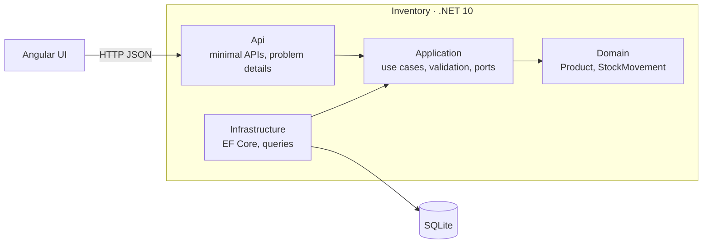
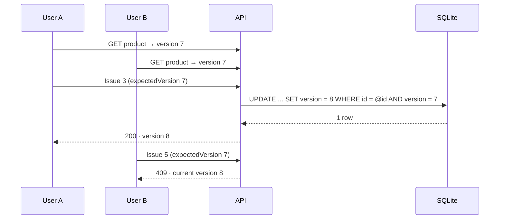

# Inventory · Clean Architecture

[](https://github.com/edybackend/inventory-clean-architecture/actions/workflows/ci.yml)
[Leia em português](README.pt-BR.md)

A stock control service built as **one well-layered application**: .NET 10 with Clean Architecture,
EF Core on SQLite and an Angular UI. Stock changes only through an append-only history of movements,
and two people changing the same product at the same time can never overwrite each other.

Small on purpose: it can be read in about 15 minutes and started with one command.

## Quick start

Requirements: Docker.

```bash
docker compose up --build
```

Open http://localhost:8080. The database starts with 12 sample products, some of them below their minimum stock.

| What | Where |
|---|---|
| Web UI + API | http://localhost:8080 |
| OpenAPI document | http://localhost:8080/openapi/v1.json |
| Health check | http://localhost:8080/health |

**See the concurrency rule.** Open the same product in two browser tabs. Record an Issue in the first tab, then
another in the second. The second tab gets *"Stock changed since you opened this product"* and reloads the current quantity
instead of silently overwriting the first change.

<details>
<summary>Without Docker (.NET 10 SDK and Node 24)</summary>

```bash
cd web && npm ci && npm run build && cd ..   # writes the UI to src/Inventory.Api/wwwroot
dotnet run --project src/Inventory.Api       # http://localhost:8080
```

For UI development, run the API and `cd web && npm start` (http://localhost:4200, proxies `/api` to the API).
</details>

## Architecture



Dependencies point inwards. `Domain` knows nothing else; `Application` declares the ports (`IProductRepository`,
`IUnitOfWork`, `IProductQueries`) and `Infrastructure` implements them. Architecture tests fail the build if a layer
references the wrong one.

### How a lost update is prevented



There are two guards. The handler compares `expectedVersion` with the version it loaded. If two requests load
the same version at the same instant, the `version` column (an EF Core concurrency token) makes the second `UPDATE`
affect zero rows, and that request also gets `409`. An integration test fires eight simultaneous requests and
asserts that exactly one wins.

## API

| Method | Route | Result |
|---|---|---|
| `POST` | `/api/products` | `201` · `400` invalid fields · `409` duplicate SKU |
| `GET` | `/api/products?search=&belowMinimum=&page=&pageSize=` | paged list |
| `GET` | `/api/products/{id}` | product with `version` · `404` |
| `POST` | `/api/products/{id}/movements` | `200` new balance · `400` · `404` · `409` stale version · `422` not enough stock |
| `GET` | `/api/products/{id}/movements?page=&pageSize=` | history, newest first |

Movement types: `Receipt` adds units, `Issue` removes units, `Adjustment` sets the balance to a physical count.
Every error is an RFC 9457 problem details response.

## Tech stack

| Area | Choice |
|---|---|
| Back-end | .NET 10, minimal APIs, EF Core 10 + SQLite, FluentValidation, OpenAPI |
| Front-end | Angular 22 (standalone components, signals, lazy routes), TypeScript strict |
| Quality | xUnit v3, WebApplicationFactory, NetArchTest, Vitest, Roslyn analyzers (warnings as errors) |
| Delivery | Multi-stage non-root image, Docker Compose, GitHub Actions |

## Project structure

```
src/
  Inventory.Domain/          Product aggregate, StockMovement, Sku value object
  Inventory.Application/     use cases (register product, record movement), validators, ports, read DTOs
  Inventory.Infrastructure/  EF Core DbContext, repository, unit of work, queries, migrations, sample data
  Inventory.Api/             endpoints, problem details mapping, composition root
web/                         Angular UI (built into the API's wwwroot)
tests/                       unit, integration and architecture tests
specs/                       feature specs (spec-first workflow)
```

## Design decisions

- **One deployable, clear layers.** Not every system needs microservices. This one is a single process with the dependency rule enforced by tests.
- **The balance is explained by its history.** Quantity changes only through movements; a test checks that the balance equals the sum of the history.
- **Optimistic concurrency, no locks.** A version number per product; nobody holds a lock while a screen is open.
- **Expected failures are values.** Use cases return `Result<T>`; one mapper turns failures into 400/404/409/422.
- **One ORM.** EF Core for writes and no-tracking LINQ projections for reads. A second data library would add nothing here.

## Tests

```bash
dotnet test                         # unit, integration (real API + SQLite) and architecture tests
cd web && npm ci && npm test        # Angular unit tests (Vitest)
```

## Known trade-offs

- **SQLite.** Chosen so the project runs with no external database. Writes are serialized by SQLite; a production setup would use PostgreSQL or SQL Server. The concurrency design stays the same.
- **No authentication.** Out of scope for this repository, to keep the focus on the domain and the layers.
- **Stored balance.** The product keeps its balance instead of summing the history on every read. This keeps reads fast; the invariant is protected by the domain and by tests.

## AI-Assisted Engineering

This project was built with Claude Code under explicit engineering controls:

- **Project rules** ([`CLAUDE.md`](CLAUDE.md)) define the architecture, domain rules and boundaries the agent must follow.
- **Hooks** ([`.claude/settings.json`](.claude/settings.json)) format every change, block edits to secrets and generated files, and run the quality gates before a task is considered done.
- **Spec-first**: each feature starts as a spec in [`specs/`](specs) with acceptance criteria.
- **Same quality gates for every line**: CI enforces warnings as errors, formatting, unit/integration/architecture tests, a container smoke test and secret scanning.

I own the architecture and review every change.

## License

[MIT](LICENSE)
