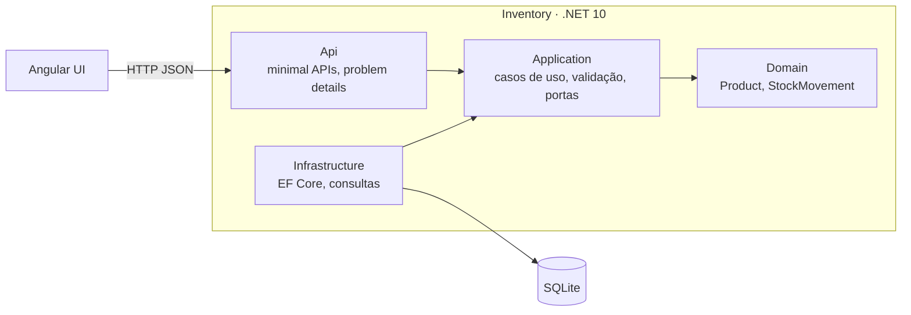
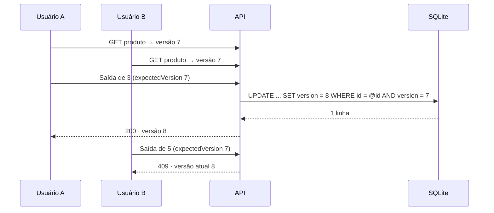

# Inventory · Clean Architecture

[](https://github.com/edybackend/inventory-clean-architecture/actions/workflows/ci.yml)
[Read in English](README.md)

Um serviço de controle de estoque feito como **uma única aplicação bem dividida em camadas**: .NET 10 com Clean Architecture,
EF Core sobre SQLite e interface em Angular. O estoque só muda por um histórico de movimentações que nunca é alterado,
e duas pessoas mexendo no mesmo produto ao mesmo tempo nunca sobrescrevem uma à outra.

Pequeno de propósito: dá para ler em cerca de 15 minutos e subir com um comando.

## Como rodar

Requisito: Docker.

```bash
docker compose up --build
```

Abra http://localhost:8080. O banco começa com 12 produtos de exemplo, alguns abaixo do estoque mínimo.

| O quê | Onde |
|---|---|
| Interface + API | http://localhost:8080 |
| Documento OpenAPI | http://localhost:8080/openapi/v1.json |
| Health check | http://localhost:8080/health |

**Veja a regra de concorrência.** Abra o mesmo produto em duas abas. Registre uma saída (Issue) na primeira aba e
outra na segunda. A segunda aba recebe *"Stock changed since you opened this product"* e recarrega a quantidade atual,
em vez de sobrescrever a primeira alteração sem avisar.

<details>
<summary>Sem Docker (.NET 10 SDK e Node 24)</summary>

```bash
cd web && npm ci && npm run build && cd ..   # gera a interface em src/Inventory.Api/wwwroot
dotnet run --project src/Inventory.Api       # http://localhost:8080
```

Para desenvolver a interface, rode a API e `cd web && npm start` (http://localhost:4200, com proxy de `/api` para a API).
</details>

## Arquitetura



As dependências apontam para dentro. `Domain` não conhece nada; `Application` declara as portas (`IProductRepository`,
`IUnitOfWork`, `IProductQueries`) e `Infrastructure` as implementa. Testes de arquitetura quebram o build se uma camada
referenciar a errada.

### Como a atualização perdida é evitada



São duas proteções. O handler compara o `expectedVersion` com a versão carregada. Se duas requisições carregam
a mesma versão no mesmo instante, a coluna `version` (concurrency token do EF Core) faz o segundo `UPDATE` afetar
zero linhas, e essa requisição também recebe `409`. Um teste de integração dispara oito requisições simultâneas e
confere que exatamente uma vence.

## API

| Método | Rota | Resultado |
|---|---|---|
| `POST` | `/api/products` | `201` · `400` campos inválidos · `409` SKU duplicado |
| `GET` | `/api/products?search=&belowMinimum=&page=&pageSize=` | lista paginada |
| `GET` | `/api/products/{id}` | produto com `version` · `404` |
| `POST` | `/api/products/{id}/movements` | `200` novo saldo · `400` · `404` · `409` versão antiga · `422` estoque insuficiente |
| `GET` | `/api/products/{id}/movements?page=&pageSize=` | histórico, do mais novo para o mais antigo |

Tipos de movimentação: `Receipt` adiciona unidades, `Issue` retira unidades, `Adjustment` define o saldo pela contagem física.
Todo erro é uma resposta RFC 9457 (problem details).

## Tecnologias

| Área | Escolha |
|---|---|
| Back-end | .NET 10, minimal APIs, EF Core 10 + SQLite, FluentValidation, OpenAPI |
| Front-end | Angular 22 (componentes standalone, signals, rotas lazy), TypeScript strict |
| Qualidade | xUnit v3, WebApplicationFactory, NetArchTest, Vitest, analisadores Roslyn (warnings como erro) |
| Entrega | Imagem multi-stage sem root, Docker Compose, GitHub Actions |

## Estrutura

```
src/
  Inventory.Domain/          agregado Product, StockMovement, value object Sku
  Inventory.Application/     casos de uso (cadastrar produto, registrar movimentação), validadores, portas, DTOs de leitura
  Inventory.Infrastructure/  DbContext do EF Core, repositório, unit of work, consultas, migrations, dados de exemplo
  Inventory.Api/             endpoints, mapeamento para problem details, composition root
web/                         interface Angular (compilada para o wwwroot da API)
tests/                       testes de unidade, integração e arquitetura
specs/                       specs das funcionalidades (spec first)
```

## Decisões de design

- **Um único deploy, camadas claras.** Nem todo sistema precisa de microsserviços. Este é um processo só, com a regra de dependência garantida por testes.
- **O saldo é explicado pelo histórico.** A quantidade só muda por movimentações; um teste confere que o saldo é igual à soma do histórico.
- **Concorrência otimista, sem lock.** Um número de versão por produto; ninguém segura lock enquanto a tela está aberta.
- **Falha esperada é valor.** Os casos de uso retornam `Result<T>`; um único mapeador transforma falhas em 400/404/409/422.
- **Um ORM só.** EF Core na escrita e projeções LINQ sem tracking na leitura. Uma segunda biblioteca de dados não acrescentaria nada aqui.

## Testes

```bash
dotnet test                         # unidade, integração (API real + SQLite) e arquitetura
cd web && npm ci && npm test        # testes do Angular (Vitest)
```

## Trade-offs conhecidos

- **SQLite.** Escolhido para o projeto rodar sem banco externo. O SQLite serializa as escritas; em produção seria PostgreSQL ou SQL Server. O desenho de concorrência continua o mesmo.
- **Sem autenticação.** Fora do escopo deste repositório, para manter o foco no domínio e nas camadas.
- **Saldo armazenado.** O produto guarda o saldo em vez de somar o histórico a cada leitura. Isso mantém a leitura rápida; a invariante é protegida pelo domínio e pelos testes.

## Engenharia assistida por IA

Este projeto foi construído com o Claude Code sob controles explícitos de engenharia:

- **Regras do projeto** ([`CLAUDE.md`](CLAUDE.md)) definem a arquitetura, as regras de domínio e os limites que o agente deve seguir.
- **Hooks** ([`.claude/settings.json`](.claude/settings.json)) formatam cada alteração, bloqueiam edição de segredos e arquivos gerados e rodam os portões de qualidade antes de uma tarefa ser considerada pronta.
- **Spec first**: cada funcionalidade começa como uma spec em [`specs/`](specs) com critérios de aceite.
- **Os mesmos portões para cada linha**: o CI exige warnings como erro, formatação, testes de unidade/integração/arquitetura, smoke test do contêiner e varredura de segredos.

A arquitetura é minha e eu reviso cada alteração.

## Licença

[MIT](LICENSE)
